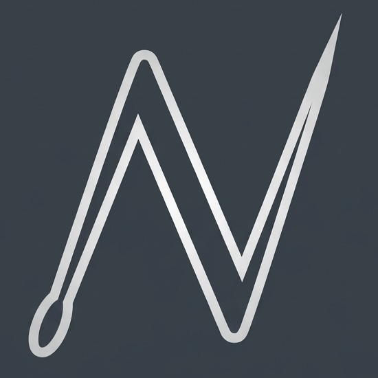
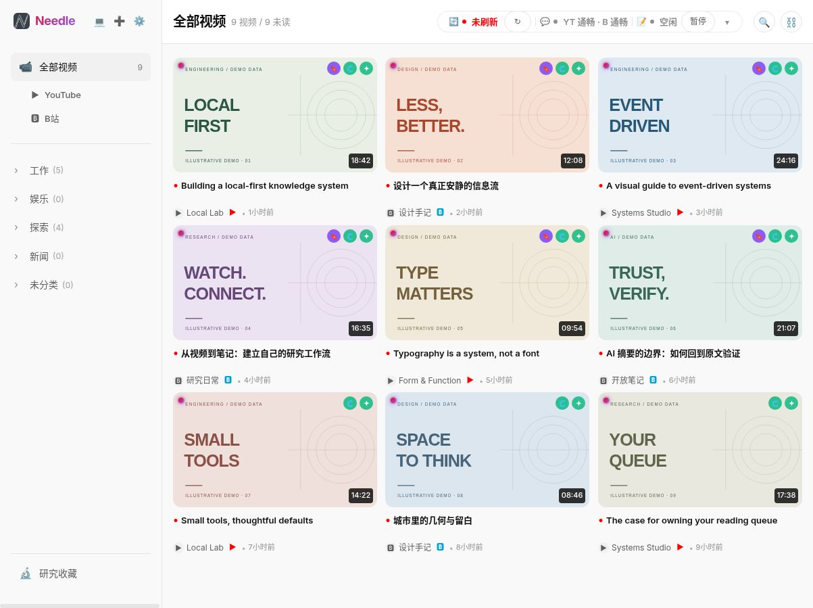
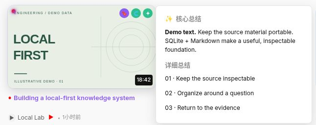
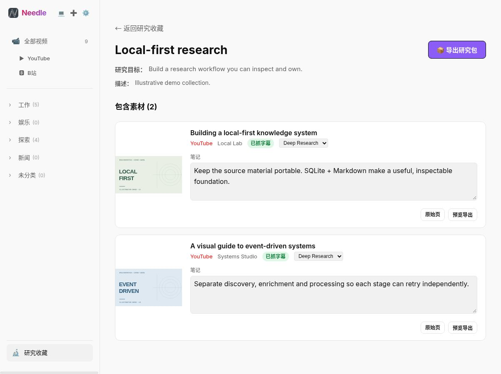
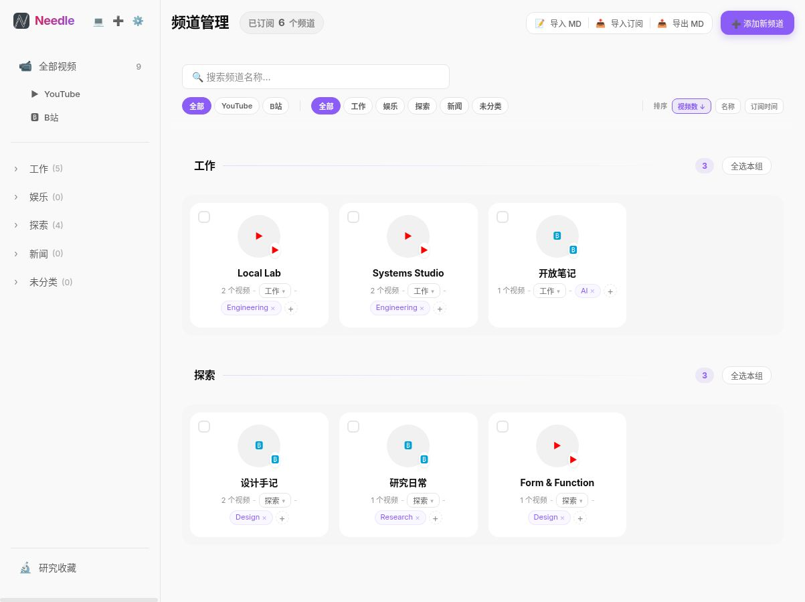

<div align="center">
  
  <h1>Needle · 觅针</h1>
  <p><strong>Turn video subscriptions into a personal research library.</strong></p>
  <p>A local-first workspace for YouTube and Bilibili.<br />Follow with intent. Read the subtitles. Keep the useful ideas.</p>
  <p><a href="./README.zh.md">简体中文</a> · <a href="#try-it">Try it</a> · <a href="./docs/README.md">Documentation</a> · <a href="./eval/README.md">Subtitle evals</a></p>
  <p><a href="./LICENSE"></a> <a href="https://nodejs.org/"></a> </p>
</div>

<picture>
  <source media="(prefers-color-scheme: dark)" srcset="./docs/assets/feed-dark.png" />
  
</picture>

<p align="center"><sub>Real app, fictional library. Chinese UI shown. All screenshots use the disposable demo dataset, not personal subscriptions.</sub></p>

## Less backlog. More understanding.

Video subscriptions are easy to collect and hard to use. Needle brings discovery, subtitles, summaries, and research notes into one workspace you control.

- **Follow with a purpose.** Organize channels by **Intent × Topics**, then filter across YouTube and Bilibili.
- **Get to the useful part.** Preview summaries from the feed, read timestamped subtitles, and ask questions about a selected segment.
- **Keep what matters.** Save videos with research notes, build collections, and export a ZIP for your next project.
- **Automate deliberately.** Enable subtitle and summary processing per intent, choose models and source order, and manage shared AI request/token budgets.

## A closer look

### Read before you watch

Hover over a video to preview its locally stored summary without losing your place in the feed.



### Build a library, not another queue

Keep a reason for saving each video. A research collection keeps source material, editable notes, and export controls together.



<details>
<summary><strong>See Intent × Topics channel organization</strong></summary>



</details>

## Try it

**Node.js 20+** and npm are required. Start with a fresh clone:

```bash
git clone https://github.com/Max-dwd/Needle.git
cd Needle
npm ci
npm run demo
```

Open **http://127.0.0.1:3100**. No account, browser extension, or AI key is needed to explore the sample feed, summary previews, channel organization, and research workspace.

The demo creates a new temporary SQLite database and sample artifacts on every launch, overrides the normal data paths, disables scheduled crawling and browser keepalive, and removes its temporary data on a normal shutdown. Video IDs, thumbnails, transcripts, and summaries are illustrative; this is a UI demo, not live video playback or an AI-quality benchmark. See [demo and screenshot notes](./docs/demo.md).

### Use your own subscriptions

```bash
cp .env.example .env.local
npm run browser:prepare
npm run dev -- --hostname 127.0.0.1
```

Open **http://127.0.0.1:3000**, then:

1. In Chrome, open `chrome://extensions`, enable **Developer mode**, choose **Load unpacked**, and select `browser-bridge/extension`.
2. Add a channel URL, import YouTube OPML, or import a Bilibili following list. Account-specific operations may require platform sign-in.
3. Configure providers in **Settings → Models**. Choose subtitle sources and opt into automation per intent.

Native captions, Whisper + AI correction, LLM transcription + forced alignment, and multimodal fallback have different runtime requirements. See [configuration](./docs/configuration.md) before enabling optional methods.

> [!WARNING]
> **Single-user, trusted environments only.** API routes have no authentication. Bind to localhost or put Needle behind your own trusted access controls. Do not expose it directly to the public internet.

> [!NOTE]
> **Local-first does not mean offline-only.** SQLite, subtitles, summaries, notes, and backups are stored locally. Platform requests contact YouTube/Bilibili; enabled AI features send the relevant text or audio to your configured provider. Keep API keys, cookies, databases, and backups out of Git and screenshots.

## Built to be inspectable

```text
YouTube / Bilibili
        ↓  Needle Browser runtime + Chrome bridge
Video discovery → subtitle pipeline → AI summaries
        ↓                 ↓                 ↓
      SQLite      local subtitle files    Markdown
        └────────── research collections ───┘
```

- **Next.js 16 + React 19 + TypeScript** for the app and API routes.
- **SQLite + plain files** for inspectable storage, backup, and export.
- **Event-driven queues + SSE** for processing and live progress. Automation depends on your per-intent settings, available sources, and provider configuration.
- **MCP server** for intent context, video search, subtitle access, and agent artifacts.

The [architecture guide](./docs/project-details.md) covers the data model, queues, routes, and browser subprojects.

### Measuring subtitle quality

The [eval harness](./eval/README.md) compares fallback transcripts against browser-caption references using text coverage, error rate, and timing error. Its documented **June 8, 2026 comparison covers four cases**, not the whole dataset: self-timed transcription was competitive on short clips, while forced alignment was more reliable on the included 38-minute case. These are historical observations, not a fresh benchmark or a general accuracy guarantee.

<details>
<summary><strong>Development, Docker, and maintenance commands</strong></summary>

```bash
npm run typecheck
npm test
npm run lint
npm run format:check
npm run build
npm run start -- --hostname 127.0.0.1
npm run browser:prepare
npm run backup
npm run restore
npm run mcp:start
```

```bash
# Docker: the Chrome bridge still runs on the host.
cp .env.example .env.local
docker compose up -d --build
```

See [Docker and runtime configuration](./docs/configuration.md), [subtitle export](./docs/project-details.md), and the [eval commands](./eval/README.md). Optional MLX-based tools have platform-specific requirements.

</details>

## Explore the project

- [Configuration](./docs/configuration.md): providers, imports, browser setup, optional runtimes, and Docker.
- [Architecture](./docs/project-details.md): data layout, API routes, pipelines, and storage.
- [Demo & screenshots](./docs/demo.md): reproducible, privacy-safe presentation assets.
- [Subtitle evals](./eval/README.md): methods, metrics, historical results, and limitations.
- [Contributor navigation](./AGENTS.md): source map and development conventions.

MIT licensed. See [LICENSE](./LICENSE).
