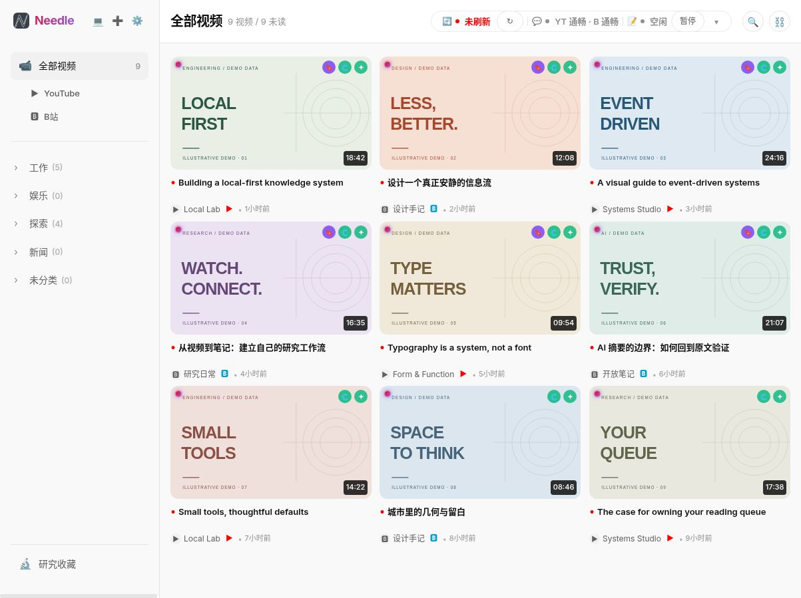
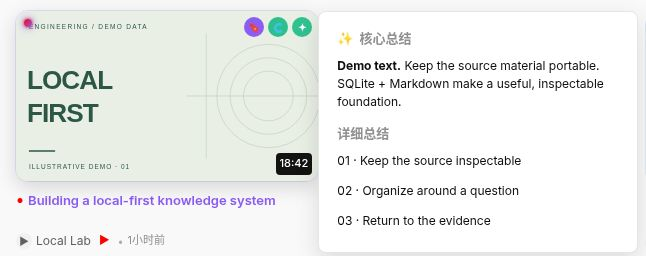
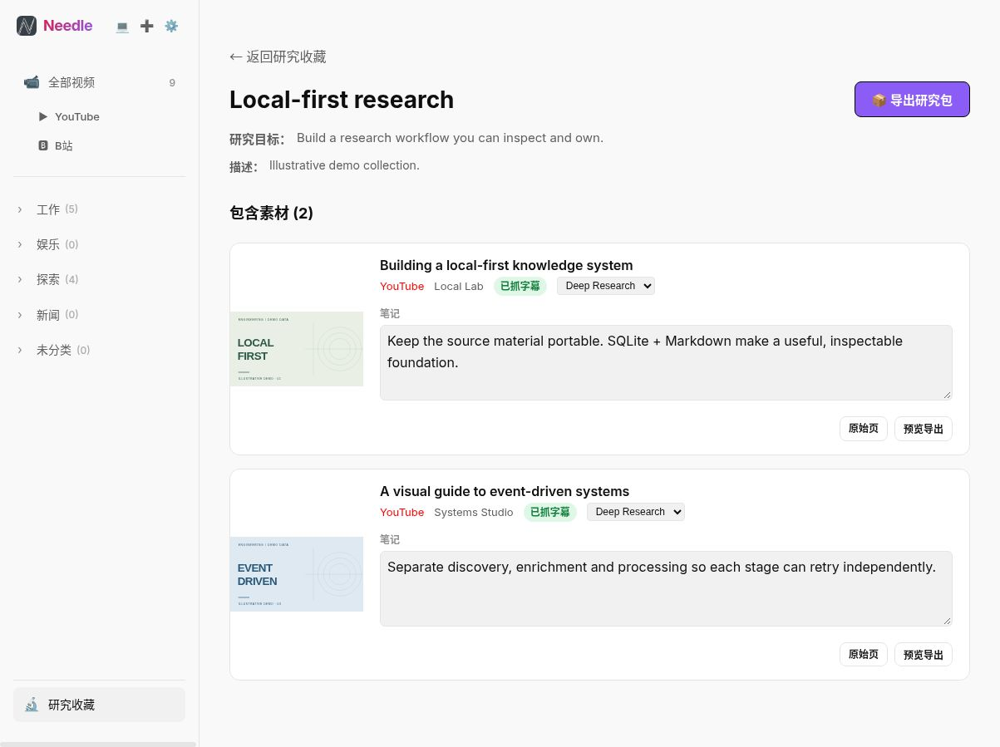
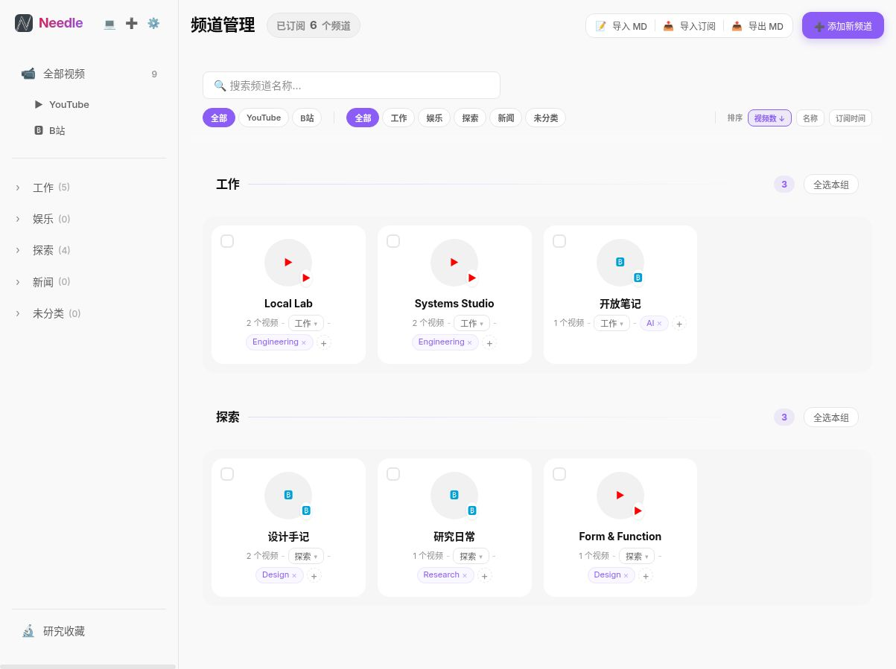

<div align="center">
  
  <h1>Needle · 觅针</h1>
  <p><strong>把视频订阅，变成自己的研究资料库。</strong></p>
  <p>本地优先的 YouTube 与 Bilibili 工作台。<br />带着目的订阅，读懂字幕，留下有用的想法。</p>
  <p><a href="./README.md">English</a> · <a href="#快速体验">快速体验</a> · <a href="./docs/README.zh.md">文档</a> · <a href="./eval/README.md">字幕评测</a></p>
  <p><a href="./LICENSE"></a> <a href="https://nodejs.org/"></a> </p>
</div>

<picture>
  <source media="(prefers-color-scheme: dark)" srcset="./docs/assets/feed-dark.png" />
  
</picture>

<p align="center"><sub>真实应用，虚构资料库。所有截图均来自一次性演示数据，不包含个人订阅。</sub></p>

## 少一点积压，多一点理解

订阅很容易，真正用上内容却不容易。Needle 把发现视频、阅读字幕、查看摘要和整理研究笔记放在同一个由你掌控的工作台里。

- **带着目的订阅。** 用 **意图 × 主题** 组织频道，统一筛选 YouTube 与 Bilibili 内容。
- **快速找到重点。** 在视频流中预览摘要，阅读带时间戳的字幕，对选定片段发起 AI 问答。
- **留下有用的内容。** 为收藏写下研究笔记，整理清单，再导出 ZIP 用于后续项目。
- **按需开启自动化。** 为每个意图设置字幕和摘要任务，选择模型与来源顺序，管理共享的 AI 请求和 Token 预算。

## 看看实际体验

### 先读重点，再决定是否观看

悬停在视频卡片上，就能预览本地保存的摘要，无需离开当前视频流。



### 收藏理由，不只是收藏链接

把原始视频、笔记和研究清单放在一起，让每次收藏都能接上后续工作。



<details>
<summary><strong>查看「意图 × 主题」频道管理</strong></summary>



</details>

## 快速体验

需要 **Node.js 20+** 和 npm。从全新克隆开始：

```bash
git clone https://github.com/Max-dwd/Needle.git
cd Needle
npm ci
npm run demo
```

打开 **http://127.0.0.1:3100**。无需账号、浏览器扩展或 AI 密钥，即可体验示例视频流、摘要预览、频道管理与研究收藏。

每次启动都会创建临时 SQLite 数据库和示例文件，覆盖正常数据路径，关闭定时抓取与浏览器保活，并在正常退出时清理临时数据。视频 ID、封面、字幕和摘要均为演示内容；这不是实际视频播放，也不是 AI 效果评测。详见[演示与截图说明](./docs/demo.md)。

### 接入自己的订阅

```bash
cp .env.example .env.local
npm run browser:prepare
npm run dev -- --hostname 127.0.0.1
```

打开 **http://127.0.0.1:3000**，然后：

1. 在 Chrome 打开 `chrome://extensions`，启用**开发者模式**，选择**加载已解压的扩展程序**，载入 `browser-bridge/extension`。
2. 添加频道 URL、导入 YouTube OPML，或导入 Bilibili 关注列表。涉及账号的操作可能需要登录对应平台。
3. 在**设置 → 模型**配置 AI 服务，选择字幕来源，再按意图开启需要的自动化。

原生字幕、Whisper + AI 校对、LLM 转写 + 强制对齐，以及多模态 fallback 的运行要求不同。启用可选方法前，请查看[配置文档](./docs/configuration.zh.md)。

> [!WARNING]
> **仅适合单用户、可信环境。** API 路由没有身份验证。请绑定 localhost，或自行配置可信的访问控制，不要直接暴露到公网。

> [!NOTE]
> **本地优先不等于完全离线。** 数据库、字幕、摘要、笔记和备份保存在本地。平台请求会访问 YouTube/Bilibili；启用 AI 功能后，相关文本或音频会发送给你配置的服务商。不要将密钥、Cookie、数据库或备份提交到 Git，也不要放进截图。

## 让实现可以被理解

```text
YouTube / Bilibili
        ↓  Needle Browser runtime + Chrome bridge
发现视频 → 字幕流水线 → AI 摘要
    ↓          ↓           ↓
  SQLite    本地字幕文件   Markdown
    └──────── 研究清单 ──────┘
```

- **Next.js 16 + React 19 + TypeScript**：应用界面与 API 路由。
- **SQLite + 普通文件**：可检查、可备份、可导出的数据存储。
- **事件驱动队列 + SSE**：处理任务与实时状态。自动化行为取决于每个意图的开关、可用来源和模型配置。
- **MCP Server**：提供意图上下文、视频搜索、字幕读取和 Agent 产物接口。

[架构文档](./docs/project-details.zh.md)介绍数据模型、队列、API 与浏览器子项目。

### 字幕质量怎么衡量

[评测工具](./eval/README.md)以浏览器字幕为参考，比较 fallback 转写的文本覆盖率、错误率和时间戳误差。文档中的 **2026 年 6 月 8 日对比只覆盖 4 个案例**，不是完整数据集：自带时间戳的转写在短视频中有竞争力，强制对齐在其中一个 38 分钟案例中更稳定。这是历史观察，不是本次重新运行的 benchmark，也不代表普遍准确率保证。

<details>
<summary><strong>开发、Docker 与维护命令</strong></summary>

```bash
npm run typecheck
npm test
npm run lint
npm run format:check
npm run build
npm run start -- --hostname 127.0.0.1
npm run browser:prepare
npm run backup
npm run restore
npm run mcp:start
```

```bash
# Docker 中运行 Web 应用，Chrome Bridge 仍在宿主机运行。
cp .env.example .env.local
docker compose up -d --build
```

详见 [Docker 与运行时配置](./docs/configuration.zh.md)、[字幕导出](./docs/project-details.zh.md)和[评测命令](./eval/README.md)。可选的 MLX 工具有特定平台要求。

</details>

## 继续了解

- [配置文档](./docs/configuration.zh.md)：模型、导入、浏览器、可选运行时与 Docker。
- [架构文档](./docs/project-details.zh.md)：数据布局、API、流水线与存储。
- [演示与截图](./docs/demo.md)：可复现、不含个人订阅的展示素材。
- [字幕评测](./eval/README.md)：方法、指标、历史结果与局限。
- [贡献者导航](./AGENTS.md)：源码地图与开发约定。

采用 MIT 许可证，见 [LICENSE](./LICENSE)。
